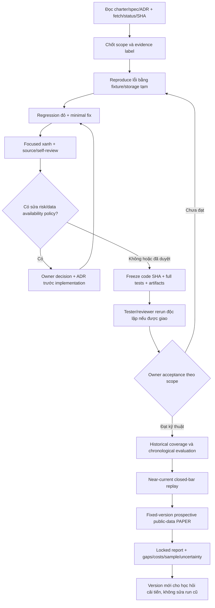
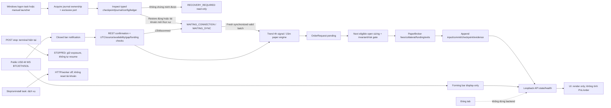

# Project Workflow Implementation Plan

> **For agentic workers:** Thực hiện inline trong cùng conversation theo superpowers:executing-plans khi chủ dự án yêu cầu triển khai. Không dispatch sub-agent hoặc tạo chat mới tự động. Các bước chưa check là đề xuất, không phải công việc đã chạy hay gate accepted.

**Goal:** Hoàn thiện paper/research bot có thể kiểm chứng, giữ tài khoản và evidence đúng, rồi đánh giá dữ liệu cũ/gần đây/prospective mà không làm lệch ý tưởng ban đầu.

**Architecture:** Tái sử dụng engine/risk/logger hiện có. Tách historical research với realtime paper transport; mọi entry phải qua broker hoặc basket gate trước mutation. UI chỉ đọc backend/artifact; kết quả nghiên cứu không tự promote vào scanner.

**Tech Stack:** Python/.venv-paper, pandas/Parquet, PaperBroker, SQLite + JSONL/checkpoint v2, Gymnasium/SB3 CPU; React/Vite; Windows loopback HTTP và optional Scheduled Task.

**Spec:** [charter và gates](../../planning/PRODUCT_CHARTER_AND_GATE_SPEC.md), [master spec](../../specs/CRYPTO_PAPER_TRADING_AGENT_MASTER_SPEC.md), [ADR](../../adr/), [API v2](../../../crypto-paper-agent/docs/operations/PAPER_STREAM_API.md), [recovery v2](../../../crypto-paper-agent/docs/operations/PAPER_STREAM_RECOVERY_V2.md). Findings đầu vào: [audit 2026-09-30](../../reviews/2026-09-30-project-assessment.md).

## Global constraints

- PAPER TRADING ONLY; không exchange order/testnet/API key/wallet/private key/signing/withdrawal; không paid resource.
- 10.000 USDT giả định chỉ ở tài khoản mới; không cấp lại vốn, xóa journal hoặc bypass RECOVERY_REQUIRED để resume.
- Stop-loss mọi directional entry, leverage tối đa 5x, sizing/margin/news/breaker bắt buộc; after_3_wins theo ADR 0002.
- Funding 00/08/16 UTC; exact source identity + readiness fail-closed. Source event time không thay receipt/availability.
- UTC/closed-bar/next-open; features/swing không backdate; không fake volume/price/PnL/funding/OI/CVD.
- Giữ lịch sử/config/strategy/risk hiện hành; không tuning để tạo giao dịch hoặc đạt benchmark.
- Research bốn tài khoản độc lập/fold; PPO scaler fit train only; no online learning hoặc selection trên scored holdout.
- Author verification khác independent acceptance; zero trade/negative return là kết quả hợp lệ, không lý do đổi tham số.
- Dùng nhánh codex/local-paper-futures-app làm base được kiểm lại trước triển khai; không tự merge main/force-push/rebase/squash.
- Không xóa user dirty/untracked/runtime evidence; không cài task/power setting hoặc khởi động tài khoản chủ dự án chỉ để audit.

## 1. Workflow phát triển và gate



Đây là workflow quản lý/phát triển, **không phải GitHub Actions đã cài**. G0–G6 vẫn theo charter; task dưới chỉ sắp thứ tự repair/verification, không tự tạo gate accepted. Không cần đóng research-economic gate để sửa input/cache hoặc regression harness.

## 2. Workflow vận hành Windows và data flow



Node journal ownership là **repair cần triển khai**, chưa có lifetime lock ở SHA audit. Các nhánh error phải giữ evidence và cause; không vẽ như recovery luôn thành công. Không dùng chart timeframe selection để thay chiến lược.

## 3. Cây tác vụ, phụ thuộc và đầu ra

| Task | Ưu tiên / phụ thuộc | Phạm vi | Đầu ra và exit evidence |
| --- | --- | --- | --- |
| T0 Harness + documentation identity | P1, bắt đầu ngay khi được giao triển khai | Historical probe ROOT; INDEX/handover/state/routing/architecture | Review05/06/07 nguyên trạng 26/11/3 pass hoặc phân loại fail mới; path/branch/ADR status cùng checkpoint |
| T1 Input + cache correctness | P1, độc lập T0 | data_layer, backtest validator, negative tests | Volume lỗi bị reject trước mutation; sparse-cache miss/fallback có network budget và không len(None); raw identity/gaps đúng |
| T2 Single-writer ownership | P1, sau scope freeze; độc lập T1 | paper journal/server, Python process tests | Same journal different ports/processes/aliases chỉ một owner; restart sau owner death; evidence byte-preserved |
| T3 Realtime funding availability | P1, cần owner quyết định policy | ADR proposal → paper transport/recovery/tests/API | Exact event identity + receipt/decision ordering được test; settlement một lần; không backdate hoặc omit funding |
| T4 Windows recovery/operation | P1, sau T2 và T3 cho exposure E2E | Windows launch/task, recovery/API/runbook | Restarts flat/open/pending/funding/corrupt; stop service khác stop bot; public WS/logon/reboot evidence nếu chạy thật |
| T5 Freeze engineering candidate | P1, T0–T4 | full suite, CLI/operator, artifact audit | Frozen SHA, clean checkout, external CWD, schema/JSON/MD/SQLite/CSV/PNG, four synthetic nonempty rulebooks, PPO save/load |
| T6 Historical + near-current research | P2, sau technical acceptance phù hợp | data manifests, walk-forward, candidate registry | 2021-01-01→2026-09-01 coverage thực; chronological partitions; current replay riêng; no alpha claim từ sparse sample |
| T7 Prospective paper + review | P2, frozen session/candidate + safe data contract | observer/session evidence + independent review | Fixed protocol, feed clocks, rejection/funding/costs/daily reconcile, fault logs; owner mới chốt acceptance |

### Task T0: Đưa bộ kiểm định và tài liệu về đúng repository

**Files:** Modify `docs/history/reviews/test_stage_04_review_05.py`, `...06.py`, `...07.py` chỉ bootstrap ROOT; `docs/INDEX.md`, `docs/handover/PLANNER_HANDOVER.md`, `docs/planning/PM_SKILL_MCP_ROUTING.md`, `docs/architecture/architecture-and-task-tree.md`, `docs/PROJECT_STATE.md` chỉ checkpoint/path/superseded labels.

**Interfaces:** Consumes immutable HEAD và assertions lịch sử; produces cùng financial probes có config đúng và handover không dùng main cũ như branch hiện hành.

- [ ] Chạy ba files nguyên trạng, lưu error và count riêng. Không patch broker/caller detection.
- [ ] Thay bootstrap ROOT đã di chuyển bằng đường dẫn file-relative, không CWD-dependent:

```python
ROOT = Path(__file__).resolve().parents[3] / "crypto-paper-agent"
```

- [ ] Chạy từng file riêng từ crypto-paper-agent; mong đợi 26/11/3 pass nếu chỉ có lỗi path. Nếu assertion fail, mở finding riêng thay vì giảm assertion.
- [ ] Update handover/current architecture thêm backend WS, receipt clocks, v2 journal, API và Windows; giữ bản đồ reporting đúng (metrics từ broker, generator gọi logger ghi).
- [ ] Commit scoped harness/docs sau verification; không gọi independent accepted.

### Task T1: Fail-closed volume và cache seam

**Files:** Modify `crypto-paper-agent/src/backtest/engine.py`, `src/data_layer/cache_manager.py`, `src/data_layer/fetcher.py`; Test `tests/test_backtest_engine.py`, `tests/test_data_layer.py`.

**Interfaces:** `BacktestEngine.validate_dataset(df, name)` rejects bad volume; cache readiness và load không mâu thuẫn; fetch_all tôn trọng miss thay vì dereference None.

- [ ] Thêm regression đỏ cho volume trước khi sửa. Ví dụ test cụ thể:

```python
@pytest.mark.parametrize("bad", [float("nan"), float("inf"), -1.0, True])
def test_volume_invalid_is_rejected(bad):
    index = pd.date_range("2026-01-01", periods=3, freq="15min", tz="UTC")
    frame = pd.DataFrame({"open": 100., "high": 101., "low": 99.,
                          "close": 100., "volume": bad}, index=index)
    with pytest.raises((ValueError, TypeError)):
        BacktestEngine.validate_dataset(frame, "15m")
```

- [ ] Thêm sparse-cache regression: 200 slots, bỏ slots 50–99, giữ endpoints; assert miss đồng nhất. Test fallback fetch có stub public response đúng tầng adapter, chỉ để không gọi mạng; offline CLI không được tự fetch.
- [ ] Minimal fix finite/non-bool volume >=0; cache single contract + check None trước len trên OHLCV/OI/funding. Không fill khoảng trống bằng nến giả.
- [ ] Run `python -m pytest -p no:cacheprovider tests/test_backtest_engine.py tests/test_data_layer.py tests/test_public_data_pipeline.py tests/test_no_lookahead.py -q -m "not network"`; verify zero volume hợp lệ và partial/gap policy ghi rõ.
- [ ] Ghi data schema, gaps/revision/provenance/availability; commit code/tests trên SHA mới.

### Task T2: Journal ownership suốt đời process

**Files:** Modify `src/paper/local_server.py`, `src/paper/durable_journal.py`; Create `tests/test_journal_ownership.py`; update `PAPER_STREAM_API.md`/recovery docs.

**Interfaces:** Ownership acquire trước session inspection, duplicate journal owner raises RuntimeError (đề xuất contract), release khi server_close hoặc process chết; same account folder vẫn inspector-verified. Không chỉ dựa socket 8765.

- [ ] Regression đỏ hai listeners port=0 cùng journal; second phải reject. Có finally đóng first và second nếu implementation cũ còn cho phép second; không để test leak server.
- [ ] Thêm test hai subprocess cùng journal khác cổng: process B không restore/write/start; bytes account/jsonl không đổi; kill A rồi B mới được acquire theo lock semantics. Không dùng PID tồn tại đơn thuần làm bằng chứng ownership.
- [ ] Implement OS-supported lifetime lock phù hợp Windows, xác định canonical path và vị trí lock không làm inspector xem là orphan account. Không đổi format funding/risk/ledger.
- [ ] Run ownership + `tests/test_local_paper_server.py tests/test_paper_resume.py tests/test_paper_recovery_review.py tests/test_paper_windows_lifecycle.py`; test occupied port vẫn đúng; code self-review cleanup/startup failure paths.
- [ ] Commit code/tests; lưu exact process evidence, không cài Scheduled Task của chủ dự án trong pytest.

### Task T3: Quyết định availability funding, rồi mới nối E2E

**Files:** Create proposal `docs/adr/0013-realtime-funding-availability.md` (chỉ PROPOSED cho tới owner phê duyệt); Modify `live_session.py`, `public_stream.py`, `recovery_state.py`, API docs/schema/tests khi policy được chốt.

**Interfaces:** Input exact public funding event và receipt/availability clocks; output settlement pending/committed/error có event ID và idempotency, trước mọi mutation liên quan. Không gán available_at bằng fundingTime để qua gate.

- [ ] Tái hiện F-04 bằng audit probe: exact source, receipt delay=0 vs 900000; ghi rõ closed-bar receipt luôn sau open.
- [ ] Đưa owner lựa chọn mô hình deferred settlement có thể chứng minh hoặc phạm vi observe-only/block admission khi không đáp ứng; ghi tương tác broker's event clock, funding-at-open và restart pending obligation. Không mặc định policy mới approved.
- [ ] Sau owner decision, viết regression settlement đúng một lần, missing/late/revised/future/bool/NaN fail trước mutation; repeated restart không double charge; equity/collateral/ledger oracle.
- [ ] Run `tests/test_local_paper_session.py tests/test_local_paper_stream.py tests/test_paper_resume.py tests/test_paper_recovery_review.py tests/test_g0_settlement_lifecycle.py tests/test_execution_accounting.py`; kiểm timestamp receipt/decision không backdate.
- [ ] Commit chỉ sau code/ADR semantics nhất quán. Nếu chưa có quyết định, T3=DECISION_REQUIRED; tiếp tục T0/T1/T2 độc lập, không ép bot nhận order.

### Task T4: Kiểm chứng vận hành Windows bằng tài khoản thử tách biệt

**Files:** `scripts/windows/*.ps1`, `scripts/run_local_paper_web.py`, `tests/test_paper_windows_lifecycle.py`, paper recovery tests, `docs/operations/LOCAL_PAPER_WEB.md` và API contract.

**Interfaces:** Manual/logon start cùng journal path, một owner; health có timestamps/state/reason; POST stop terminal khác service stop/uninstall; không reset tài khoản legacy.

- [ ] Test restart flat, open, pending, funding, corrupt/torn journal; outage dài hơn REST window phải giữ RECOVERY_REQUIRED nếu không chứng minh fills/funding. Chạy nhiều restart + duplicate events so ID/fee/funding counts.
- [ ] Kiểm logon task command/log path/restart settings, startup failure và duplicate port; không npm install/build mỗi lần logon. Không tự đổi sleep; hướng dẫn user chọn Never when plugged in.
- [ ] Nếu được phép kiểm operator task thật, dùng task name/journal thử tách riêng, cài–start–stop–remove; giữ journal/log bằng chứng. Phân biệt pytest Windows subprocess pass với logon/reboot thật.
- [ ] Public-feed test bounded 15–60s hoặc một đóng nến đủ để chứng minh processing; report REST vs WS riêng. Không thấy signal báo 0 orders; fixture LONG/SHORT riêng chứng minh create/close. Không nhận WS ghi BLOCKED với lỗi, không giả vờ realtime tested.
- [ ] Health/state/start/stop + UI reconnect được kiểm trên cùng frozen commit; nếu không browser verify ghi NOT_VERIFIED. API examples phải từ session methods thật và validate JSON schema.

### Task T5: Frozen engineering verification

**Files:** test/reproduction scripts và docs evidence; không sửa rule parameters.

- [ ] Freeze code SHA A; tạo clean checkout thích hợp bằng product tools sau kiểm worktrees, không copy data/raw ngoài Git làm pass giả.
- [ ] Run full offline, historical probes nguyên trạng, focused recovery/accounting/input/future perturbation, npm test/build. Chạy network tests riêng khi có budget; không trộn skip mạng thành pass.
- [ ] `scripts/verify_quickstart.py --output <new>` từ external CWD với temporary cache/config: bốn rulebooks có nonempty synthetic evidence; PPO CPU/train/save/load/evaluate/check_env; so artifacts/schema/checksum/portable paths/account oracle.
- [ ] Self-review diff như đối thủ; sửa Critical/High trên SHA mới và rerun impacted gates. Không gán AUTHOR_SELF_REVIEWED thành independent review.
- [ ] Docs commit B ghi full Code-under-test A; exact results, limits/data/model/config hashes; branch/local-origin sync sau push nếu được yêu cầu. Không tự merge main hoặc tuyên bố project complete.

### Task T6–T7: Học hỏi và đánh giá thực tế theo phiên có phiên bản

**Files:** dataset/run registry manifests trong research artifacts, `research/workflow.py` chỉ khi lỗi được chứng minh; bounded download/reproduction scripts; scored protocol/handoff docs.

- [ ] G2 coverage per instrument/year/regime: OHLCV/OI/taker/CVD/spot/perp/funding required vs missing, raw/normalized hashes, source version, collection/availability timestamps; không lấy spot thay futures.
- [ ] Freeze candidate trước kết quả OOS; train/validation/test UTC half-open không overlap; không train 2024–2026 rồi gọi 2021 contemporaneous OOS. Rerun development-era benchmark chỉ là reproducibility diagnostic.
- [ ] Run historical canonical 2021-01-01→2026-09-01 nếu data/budget đáp ứng; nếu partial publish manifest exact intervals/missing years, không EMPIRICAL VALIDATION COMPLETE.
- [ ] Near-current closed-bar replay riêng rồi prospective fixed-version paper session; không trộn retrospective và prospective results. Price feed thật, order/equity/PnL mô phỏng; thresholds/session duration phải owner freeze trước khi scored.
- [ ] Report net fees/slippage/funding/liquidation/collateral, whole-position samples khác partial slices, drawdown/exposure/cost sensitivity/uncertainty, zero trade/losing PPO không che. Mỗi cải tiến học offline tạo version mới; risk envelope bất biến.
- [ ] Independent tester/reviewer chỉ khi owner giao; PM không tự nhận acceptance. Owner quyết định next product; workflow này không mở nhánh live/testnet.

## 4. Hợp đồng bàn giao chống mất context

Mỗi task chỉ có một scope và một handoff có version, không sao chép toàn chat:

```text
Task/gate, status: PROPOSED | IMPLEMENTED | AUTHOR_SELF_REVIEWED | NOT_VERIFIED | BLOCKED
Repository/root, branch/base SHA, code-under-test SHA, docs SHA thực
Dirty files trước/sau; phạm vi được phép và không được sửa
Spec/ADR/owner decisions áp dụng và conflicts/superseded
Finding ID → reproducer → code/test change → verified result
Data/config/model/scaler/artifact IDs và source/availability ranges
Commands + runtime + pass/fail/skip/deselected/time/exit
Windows process vs logon/reboot; REST vs WS; browser vs unit test
Remaining findings, exact blocker, next bounded action và next owner
No main merge; no live/testnet/keys; no independent acceptance/profit claim
```

## 5. Plan self-review và trạng thái hiện tại

- [x] Đối chiếu source/HEAD/spec và lỗi audit trước khi đề xuất task.
- [x] Phân biệt repair code, lỗi test harness, document drift, policy decision và thiếu operational/economic evidence.
- [x] Gắn tests, dependency, outputs, negative paths và constraints vào từng task; không gọi task tương lai đã pass.
- [x] Giữ workflow research theo ý tưởng cũ→gần đây→prospective; không curve-fit hoặc học online trong scored run.
- [ ] T0–T7 implementation: **chưa thực hiện trong lượt tạo workflow/đánh giá này**.

Không hẹn 24/7, không đưa tỷ lệ phần trăm hoàn thành không có cơ sở. Bước thực thi đề xuất đầu tiên là T0/T1/T2 trên nhánh codex scoped, sau khi chủ dự án giao triển khai; T3 chỉ đổi policy khi có quyết định riêng.
