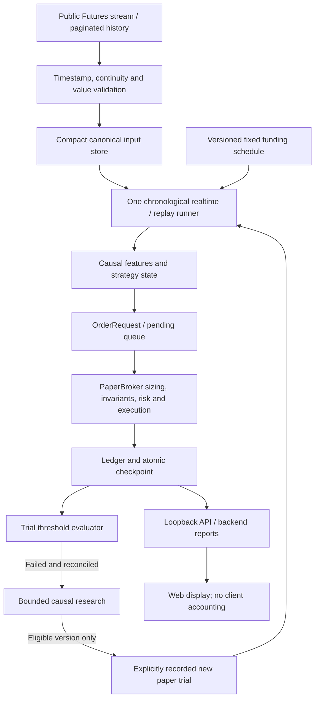

# Windows Paper Bot: Causal Replay and Strategy Trials

Date: 2026-10-01. Design author: Codex. Review: AUTHOR_SELF_REVIEWED.
Owner approved the product direction in this conversation, including the final
funding schedule. This written specification awaits owner review before the
writing-plans/implementation phase. Nothing below claims implemented behavior,
independent acceptance, profitable trading or demonstrated continuous operation.

## 1. Goal and verified baseline

Deliver a local Windows Binance USD-M Futures PAPER/RESEARCH bot for BTCUSDT,
ETHUSDT and SOLUSDT. One shared account starts with 10,000 imaginary USDT.
The backend operates independently of browser tabs, restores durable state,
replays interruptions causally and exposes broker-owned results to the web.

Verified after `git fetch origin --prune` on 2026-10-01:

- Source checkout/origin: `codex/web-chart-timeframes-and-signals`,
  `1876b134684be6e925d954c4bd3635b61d33fcdc`.
- Development base/origin: `codex/local-paper-futures-app`,
  `d1cd95a726e12245ede22326e05b09990975ccd6`.
- Main/origin: `fe1c1330d913e78239db575ff8433cf069fe1b01`.
- Design/implementation branch: `codex/windows-paper-replay`, created from the
  source checkout without another worktree. No merge into main is authorized.
- Preserve the existing local INDEX change and untracked audit/workflow files.

Existing components to reuse: public stream/REST adapter, PaperBroker and its
atomic multi-symbol processing, typed recovery checkpoint, Trend and Breakout
rulebooks, research validation/reporting, loopback API and Windows launchers.
Only Trend Following is currently connected to the realtime account. This
design does not claim that Breakout, SMC, Funding Arbitrage or PPO is active.

## 2. Owner decisions and changes to earlier rules

| Decision | Previous behavior/policy | New authorized direction |
| --- | --- | --- |
| Recovery | Exposure gaps blocked; a flat gap could skip signals | Replay the entire missing interval, including new strategy signals |
| Data retention | Raw responses and full API histories repeated in journal batches | Retain canonical decision inputs once, compact events and recovery state |
| Funding | Public funding provenance required | Fixed SIMULATED positive rate 0.0001 per settlement for all three symbols |
| Funding schedule | 00/08/16 UTC | Display 07/15/23 UTC+7; internal instants remain 00/08/16 UTC |
| Capital | No automatic new trial | No restart reset; a failed trial may be replaced only after validated research |
| Failure | No trial-level 50% rule | Equity strictly below 50% of that trial's initial capital retires it |
| Milestone | No trial-level 150% rule | Equity at least 150% records TARGET_REACHED; continue the same trial |
| Research promotion | No automatic paper promotion | Bounded, versioned selection may promote a validated compatible rulebook to a new PAPER trial |
| External knowledge | Founding documents as initial reference | Methods, formulas and implementations may be researched externally before being admitted |

These changes apply only to this named paper experiment. They do not weaken
real-source funding validation in other research/basket modes. Stop-loss,
leverage cap, fee/slippage accounting, liquidation, news policy and Circuit
Breaker semantics remain unchanged. The 50% trial failure threshold is not a
new per-trade risk budget or replacement for the earlier daily loss breaker.

Implementation must add a scoped decision/ADR and update affected governance,
API and operations documents; historical decisions remain preserved. This
specification records authority, not a silent edit to an accepted ADR.

## 3. Architecture and execution boundaries

Strategies request actions; the broker owns admission, sizing, fills, exits,
collateral, cash, fees, funding and financial reconciliation. Replay cannot
bypass the broker or execute retrospective fills directly in the ledger.

The initial supported catalog contains immutable versions of Trend Following
and Breakout & Retest, both using 4h signals and 15m execution. Trend stays the
initial baseline. Breakout becomes eligible only after its realtime/recovery
adapter passes the same gates. SMC/PPO remain research-only in this milestone.
Funding Arbitrage is excluded from automatic selection under fixed positive
funding: this artificial rate is not evidence of a funding arbitrage edge.

## 4. Chronology and no-lookahead contract

1. Acquire exclusive account ownership before loading, restoring or starting a
   writer. Verify the saved account, config/model versions and committed input
   boundary; never create an account because evidence is missing or corrupt.
2. Fix a catch-up target at the latest complete, synchronized public boundary.
   Download every required interval from the last committed watermark, using
   pagination rather than assuming a recent 12/500-candle window is sufficient.
3. Require UTC, increasing unique times, complete intervals and matching
   BTC/ETH/SOL boundaries. Reject NaN/Inf/bools, negative volume, invalid OHLC
   geometry and inconsistent duplicate revisions before financial mutation.
   Normalize each bar to the half-open interval `[open, open + interval)`;
   preserve the original exchange close timestamp separately rather than
   allowing millisecond rounding to change eligibility.
4. Feed exactly one chronological execution batch at a time. A decision at `t`
   can access only bars closed by `t`, causal indicator state and auxiliary
   inputs valid under their declared availability policy. A downloaded future
   suffix is never exposed through a strategy history or account mark.
5. Use the existing five-phase broker ordering: open/gap protection, funding,
   pending admission at the eligible open, conservative intrabar protection,
   close/mark-to-market. Strategy signals and trailing updates follow the
   completed signal bar; no same-bar retrospective entry.
6. Use fixed symbol ordering and identical feature seeds/warmup semantics in
   realtime and replay. Persist recursive indicator state or reconstruct it
   from the identical retained prefix; sliding REST windows must not reseed
   EMA/RSI/ATR differently after a restart.
7. Commit inputs, resulting financial events, trial events and checkpoint as
   one recoverable batch. Advance watermarks only after durable commit.
8. Label catch-up outputs REPLAY, keeping both simulated time and actual receipt/
   processing time. After catching up, wait for a fresh verified stream batch
   before enabling prospective operation. A stale replay price is not live.

Warmup initializes features/setup state before a trial starts; it cannot open
paper positions. This is distinct from catch-up replay, where trading resumes
from an already-running trial and may generate new orders.

Strategy selection is also causal. A replacement at simulated time `t` may
use only an eligible catalog available by `t` and research data closed by `t`.
A recipe newly researched today cannot be backdated into an older replay.
If a failed replay trial has no causally eligible replacement, retain the
failure and wait; do not erase it or skip ahead as though trades occurred.

OI/news/CVD missingness follows the registered recipe and existing gate policy;
do not invent values. Fixed funding is predetermined configuration, not a
historical public observation whose receipt timestamp can be manufactured.

## 5. Fixed funding contract

- Model identity: `FIXED_SIMULATED`, with immutable version and effective time.
- Rate: positive `0.0001` (0.01%) for BTCUSDT/ETHUSDT/SOLUSDT.
- Display timezone: fixed UTC+07:00, no dependence on Windows timezone/DST.
- Local settlement hours: `[7, 15, 23]`; canonical UTC hours: `[0, 8, 16]`.
- Cashflow: `-direction * eligible_quantity * settlement_price * 0.0001`;
  direction is +1 LONG and -1 SHORT. At 10,000 USDT settlement notional, LONG
  pays 1 USDT and SHORT receives 1 USDT. Account equity is not position notional.
- Keep existing broker eligibility/phase ordering: exposure eligible before
  settlement and surviving the earlier gap-exit phase is charged; an entry
  later in the same settlement batch is not charged for that instant.
- Use the broker's declared settlement price proxy, not an invented market
  quote. Model/proxy identity appears in API/report data and checksums.
- Key each event by trial, position identity, symbol, model version and UTC
  settlement instant. Restart, overlap downloads and retry cannot double-pay.
- Receipt after the event is recorded honestly; replay derives this fixed
  charge from pre-existing configuration, not a future observed funding rate.
- Invalid/missing fixed-model configuration fails closed. A missing Binance
  funding response does not block this fixed-mode experiment.
- Public-source funding mode keeps its strict source-event/provenance checks.
  Never construct fake public `funding_readiness` to route fixed events through
  a public-only validation path.

Existing verified accounts retain wallet, exposure, ledger and risk state.
Adopting fixed funding requires a recorded model change effective at an
unprocessed boundary, without recalculating past charges. Unreconciled public
funding obligations before that boundary remain blocked until resolved; a
switch must not erase a debt or convert unknown values to zero.

## 6. Storage, ownership and recovery

Use a versioned transactional SQLite paper store, separate from legacy JSONL
evidence, reusing the project's standard sqlite3 conventions. This bounds
duplicate storage and makes a batch checkpoint and its events atomic. Use
`synchronous=FULL`, verified transaction boundaries, foreign keys and a schema
version; WAL/checkpoint behavior must be exercised on Windows.

Retain only:

- Canonical closed execution/signal bars used by the run, including exact
  needed fields, instrument/timeframe, event/close/receipt times and checksums.
  Warmup is stored once; later overlapping downloads deduplicate identically.
- Recipe/config snapshots, indicator initialization/state, model changes and
  optional input availability/missingness actually relevant to decisions.
- Order/fill/position/funding/cashflow/risk/trial events and research verdicts.
- Latest complete machine checkpoint and commit/watermark identities; financial
  histories are reconstructed from event tables, not copied into every input.

Do not retain every display tick, forming candle update, duplicate raw REST
envelope, calculated feature column or full API response per batch. No automatic
TTL deletion of decision inputs or failed-trial evidence. Compression/archive
must remain lossless and checksummed; a hash without reconstructible input is
not enough. The API pages history rather than returning an unbounded ledger.

Use an OS-backed lifetime account lock as well as exclusive port 8765. The same
account cannot have two writers on different ports or through path aliases.
Distinguish a known ownership marker from financial evidence; do not broadly
ignore unknown files. OS death releases ownership; a stale marker alone cannot
grant or permanently deny ownership.

A verified legacy v2 account can migrate only by reconstructing and comparing
the entire typed state under its original saved config, then committing an
explicit migration into the new store. Original files remain unchanged.
Automatic startup is allowed only after this migration path has been tested.
Version-1/balance-only/corrupt evidence remains RECOVERY_REQUIRED; show a reason
and a read-only export/inspection path, not a reset button. Any unresolvable
legacy case requires a separately authorized reconciliation, not a new account.

After an interrupted SQLite transaction, resume from the last verified committed
boundary. Storage corruption or ambiguous legacy mutations preserve evidence
and block orders. No repair by truncating the old journal or guessing balances.

## 7. Trial lifecycle and capital

At the end of each reconciled execution batch, evaluate broker equity including
unrealized PnL and all modeled fees/funding. Marking uses only this batch's
available prices, not a future peak. Thresholds are relative to the trial's
initial 10,000 USDT, not its high-water mark:

- `equity < 5000`: append FAILED once; immediately block new entry requests and
  cancel pending entries through the broker. Manage/close remaining exposure
  with normal protective logic or a queued reduce-only exit at the next valid
  execution opportunity. Do not finalize at a stale/invented price.
- `equity >= 15000`: append TARGET_REACHED once; continue the same strategy,
  capital and risk controls. It can still fail later; the milestone is history,
  not a permanent guarantee or independent economic acceptance.
- Exactly 5,000 is not failure; exactly 15,000 reaches the target.
- Unknown/non-finite equity is RECOVERY_REQUIRED, not a threshold event.

Research may begin after failure, but no replacement trial receives capital
until old exposure, pending orders and funding are fully reconciled. One
validated promotion records exactly one new trial and 10,000 imaginary USDT
allocation. A retry/restart cannot allocate again. An active old breaker lock
cannot be bypassed by a trial change; prospective admission waits for its
recorded expiry. New trial state is explicit, never mistaken for resumed state.

The UI/report shows trial ID/version, initial/current/final equity, target/failure
times, all failed trials, allocation count and total imaginary capital supplied.
Do not stitch trial equity curves into a fictional continuously compounding
account or hide loss behind the newest 10,000 USDT balance.

## 8. Bounded research and formula validation

External books, papers, articles and repositories can inform curated recipes.
Do not add a long bibliography to user handoffs. Keep a compact internal recipe
identity/review note where needed; imported code must have compatible licensing.
External text/code is untrusted input, not permission to execute downloaded
scripts, call paid services, add credentials or change the running strategy.

Before any new recipe becomes eligible, document and test its exact LONG/SHORT
entry/exit rules, data requirements, timeframe, feature seed/warmup, missingness,
stop, leverage and cost model. Formula checks include independent hand oracles:

- EMA: `EMA_t = alpha * close_t + (1-alpha) * EMA_previous`,
  `alpha = 2/(n+1)`, with a versioned explicit seed.
- RSI: `100 - 100/(1 + average_gain/average_loss)` with explicit smoothing,
  initialization and zero-loss/flat-price cases.
- MACD: fast EMA minus slow EMA; signal EMA and histogram defined separately.
- ATR: `TR_t = max(high-low, abs(high-prev_close), abs(low-prev_close))`;
  specify first usable TR, seed and Wilder recursion if that is the recipe.
- Breakout: past-only channel and volume baseline excluding the breakout bar;
  delayed retest, timeout and invalidation remain required.

Never silently replace an existing indicator implementation because another
library has a different seed. A proven fix/new convention needs a version,
regression evidence and explicit effect on historical/recovery compatibility.

Engineering-selected promotion defaults, submitted for written-spec review:

1. Freeze the catalog, formula versions, risk/cost model, candidate identities,
   sample criteria and windows before inspecting results. No unrestricted code
   generation or runtime parameter search. At most eight registered candidates
   per research round; the initial catalog contains only the two rulebooks.
2. Use the 360 days ending at the causal selection cutoff: 180 training days,
   then 90 validation days, then a 90-day final holdout. Warmup precedes each
   partition and cannot carry positions into independent evaluation accounts.
   All ranges are half-open UTC intervals. Fixed recipes are not parameter-fitted
   on training; that partition supplies diagnostics and formula verification.
3. Rank compatible candidates on validation net expectancy, then lower marked
   drawdown, then stable recipe ID; select exactly one before final holdout.
4. Evaluate that frozen candidate once on three state-isolated consecutive 30-day
   holdout folds with fresh capital/state and complete force-close costs. Require
   at least 30 completed position lifecycles in total, at least five per fold,
   positive aggregate net expectancy, positive net PnL in at least two folds,
   and maximum marked drawdown at most 20% in every fold.
   Each fold uses one shared BTC/ETH/SOL account like the actual runner, not the
   sum of three independently capitalized symbol accounts. Temporal folds and
   position returns are not asserted to be statistically independent.
5. Repeat that same candidate with doubled fee/slippage assumptions, unchanged
   fixed funding and no retuning; require nonnegative aggregate net PnL. All
   causal, data, accounting and execution gates must pass in both cost runs.
6. Only then promote for another experimental PAPER trial. These criteria are
   experimental admission rules, not proof of profitability or statistical
   significance. A sparse or zero-trade result is INSUFFICIENT_EVIDENCE.
7. A failed final holdout does not authorize trying runners-up on that same
   holdout. Record the failure and require a new unused evaluation interval;
   used evaluation intervals cannot be relabeled untouched. No eligible result
   means WAITING_RESEARCH, without capital reset or forced trades.
8. Bound a research round to ten minutes evaluation wall time and one worker; no trading
   worker runs simultaneously against the failed account. Data acquisition is
   paginated/cached, bounded to three retries per failed page. Budget exhaustion,
   missing coverage or source revision produces a verdict, never promotion.

Existing development/public benchmark intervals are retrospective diagnostics
when already used for recipe design. A causally available recipe is necessary
but not sufficient to call historical holdout untouched. Preserve both labels.
The initial owner-selected Trend trial is a PAPER baseline, not an automatically
validated winner; subsequent automatic trials must meet the promotion contract.

## 9. API, controls and Windows operation

Keep HTTP bound to `127.0.0.1:8765`, with health/state/start/stop compatibility.
Version any changed semantics and publish schema plus backend-generated synthetic
examples before UI integration. Add explicit pause/resume controls:

- Start is idempotent: initialize only a proven genuinely new account; otherwise
  restore/resume only an eligible persisted state. Never reset a trial.
- Pause blocks new entries while the service continues protective handling and
  funding. Persist pause intent; downtime replay respects its effective period.
- Resume returns the same trial to normal operation only after integrity gates.
- Stop ends a trial via STOPPING, canceling new entries and reducing exposure
  through eligible modeled fills; report STOPPED only after reconciliation.
  It does not implicitly allocate or start a replacement trial.
- Stopping the Windows service is different: persist intent/checkpoint where
  possible; restart must honor pause/terminal stop, not silently auto-trade.

Expose connection health/freshness, source/receipt/API times, current price
validity, execution mode REALTIME or REPLAY, replay progress, risk admission,
recovery reason, fixed funding rate/schedule/timezone/model, strategy/version,
trial history and capital allocations. Broker values are the sole source of
PnL. History pagination has stable cursors; unknown financial state is null,
not zero. UI must not relabel fixed funding as exchange funding or replay as
continuous live operation. Antigravity may implement the necessary UI contract;
Codex does not assume an available channel for controlling its open desktop.

Use the existing Windows logon Scheduled Task under the current user, no admin
service/VPS requirement. Launch without a visible extra console; ensure journal
ownership and port checks. No npm install/build per startup. Retry crashed
processes with bounded backoff; after repeated failures expose logs and require
operator intervention instead of a restart storm.

Provide install, status, log, pause/resume, disable-task-and-stop-service and
uninstall instructions. Removing the task never removes account data. Explicit
service disable must prevent relaunch; bot stop must prevent automatic research
promotion until an explicit operator start. Document plugged-in sleep settings;
do not alter Windows power settings or install the task without telling the
owner. Closing the browser cannot stop the backend.

## 10. Delivery slices and acceptance

This is a coordinated product design, not permission for one monolithic rewrite.
Use sequential task-sized plans/commits with reusable foundations:

| Slice | Dependencies | Output and completion gate |
| --- | --- | --- |
| S0 Input/ownership repair | Existing audit | Volume/cache/duplicate-writer regressions; fail before mutation |
| S1 Fixed funding and recipe identity | S0 | Hand-calculated LONG/SHORT funding, UTC+7 schedule, public-mode isolation |
| S2 Compact storage and recovery | S1 | Atomic batch/migration, exact broker/risk/input restore, fault injection |
| S3 Shared causal runner | S2 | Complete paginated gap replay, identical uninterrupted/restart results |
| S4 Trials and bounded research | S3 | Threshold boundaries, no reset/duplicate allocation, causal selection and promotion gates |
| S5 Windows/API/web handoff | S2-S4 | One writer, idempotent controls, truthful schema/examples and Windows lifecycle |

Required tests: future perturbation for features/signals/orders/trades/research
selection; hand-accounting LONG/SHORT/funding; independent symbol ordering;
warming-up versus active replay; one and multiple missed settlements; empty/
malformed input; gaps longer than a REST page; partial multi-symbol arrival;
disconnect/reconnect; pending entry/close and open exposure across restart;
atomic crash points; corrupt/legacy storage; repeated restart; two processes
on same account with different ports; pause/stop/service intent; 5,000/15,000
threshold boundaries; research leakage/insufficient sample/budget/final-holdout
failure; and exactly-once allocation of a new trial.

Run focused tests for each slice and full offline gates at major checkpoints,
including historical probes after fixing their relocated config paths. Run web
tests/build/browser verification on the integrated API/UI commit. Exercise real
Windows processes and public WebSocket data without starting or overwriting the
owner's existing account. No signal during the public trial means report 0
orders; synthetic fixtures separately verify fills and exits.

Task install/logon/reboot, power-loss durability, public stream reachability,
long-running uptime and final integrated UI are not verified by this design.
Label actual unattempted checks NOT_VERIFIED and attempted external failures
BLOCKED with their concrete error. No claims of 24/7 uptime or independent
acceptance from unit tests, screenshots or a target-reaching paper trial.

## 11. Review boundary

Owner review of this written specification precedes writing-plans and code.
Numeric research defaults, SQLite migration, pause/stop semantics and the
UTC+7 interpretation are visible here for that review. Once approved, create
the first bounded implementation plan (S0/S1), preserve all existing dirty
files and keep main untouched. Final handoffs pin code/docs SHAs and distinguish
engineering evidence, PAPER target milestones and unverified economic claims.

Baseline verification for this documentation-only change: on Windows with the
existing Python 3.12.14 environment, `python -m pytest -p no:cacheprovider -q
-m "not network"` from `crypto-paper-agent` returned 510 passed, 2 skipped,
5 deselected and 2 Gymnasium warnings in 168.39 seconds. Code under test was
`1876b134684be6e925d954c4bd3635b61d33fcdc`; this is not evidence that the new
funding, compact storage, replay or automatic promotion has been implemented.
